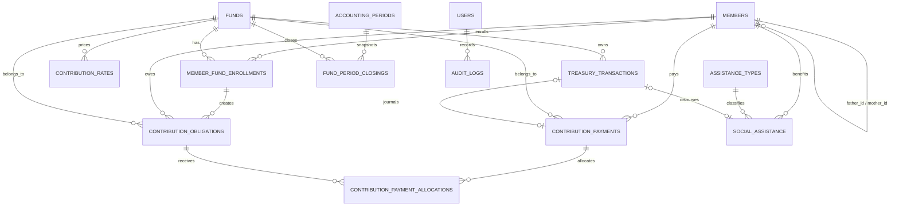

# Architecture and data model

## Entity relationships

## Tables

- `members`: the complete genealogy in one self-referencing table. `father_id` and `mother_id` are nullable foreign keys. Application validation blocks self-parenting and ancestry cycles.
- `funds`: enum-limited to the two initial codes `SOCIAL` and `AUTO_DEVELOPMENT`.
- `member_fund_enrollments`: independent effective-dated member participation. Withdrawal closes a row; re-enrollment creates a new one. A transaction lock protects the active enrollment check.
- `contribution_rates`: amount history by fund and effective date. Adding a rate closes the prior rate the day before the new one takes effect.
- `contribution_obligations`: immutable expected amount per enrollment and month, or one joining-fee obligation. A unique enrollment/type/year/month key makes generation idempotent.
- `contribution_payments`: actual receipts with unique receipt number and one linked treasury entry.
- `contribution_payment_allocations`: one payment split across one or more obligations. The service validates the payment/member/fund relationship and available obligation amount while holding locks.
- `treasury_transactions`: the financial journal. The required fund foreign key keeps every entry in exactly one ledger. Cross-fund transfer operations do not exist.
- `assistance_types`: configurable category defaults.
- `social_assistance`: workflow state and amount snapshot. Only the transition to `DISBURSED` creates a linked SOCIAL `EXIT`.
- `accounting_periods`: unique year/month with open/closed status.
- `fund_period_closings`: unique fund snapshot per period.
- `users`: password hash, role and active status. No public registration route.
- `audit_logs`: append-only record of administrative and financial events.

MySQL `CHECK` constraints cover positive amounts, calendar month ranges and effective enrollment dates (MySQL 8.0.16+). The initial migration checks for already-created tables, indexes and constraints so it can resume after MySQL commits DDL but a later migration statement fails. MySQL rejects a self-parent CHECK that references the `AUTO_INCREMENT` key, so self-parenting and ancestry-cycle validation stay in `MemberService`. Cross-record allocation limits and active-enrollment uniqueness are enforced by transaction-locked services because they depend on other rows. Treasury reversal IDs are unique so an original manual transaction cannot be reversed twice.

## Money and transactions

Database money columns are `DECIMAL(14,2)`. Services parse decimal strings into integer `BigInt` cents and serialize exact two-decimal strings. The browser uses the same integer-cent approach for totals and formatting. No balance or allocation uses binary floating-point arithmetic.

Recording a payment creates its journal entry, payment row, FIFO allocations to oldest due obligations, and audit log in one transaction. Any excess remains as unallocated payment value. A caller may submit explicit allocations instead; all member/fund and amount limits are rechecked on the server. Disbursing assistance writes the assistance state and SOCIAL exit in one transaction. Treasury corrections are append-only manual reversals with their own transaction and audit entry; source-linked contributions and assistance cannot be reversed through the generic manual endpoint.

Opening balances are separate `OPENING_BALANCE` transactions, one per fund, protected by a fund-row lock. Closing a period writes snapshots for both active funds and closes the period atomically. Transactions dated in closed periods are rejected. Future monthly obligations are not generated. Enrollments effective during a month create the full monthly obligation without proration; withdrawals in a month leave that month eligible, while a withdrawal effective before the month starts prevents it.

## Sequelize CLI migrations

Migrations and seeders are default-exported ESM modules in `src/migrations` and `src/seeders`. `.sequelizerc` points the regular sequelize-cli commands at the ESM modules and a CommonJS `config.cjs`. The package uses sequelize-cli 6.6.5 with Node.js 22.12+, whose native `require(esm)` support lets its Umzug v2 loader run these default exports. Its built-in file generator emits CommonJS, so the small `scripts/make-db-file.js` creates ESM templates; actual migration and seed execution remains `sequelize-cli db:migrate` / `db:seed:all`.